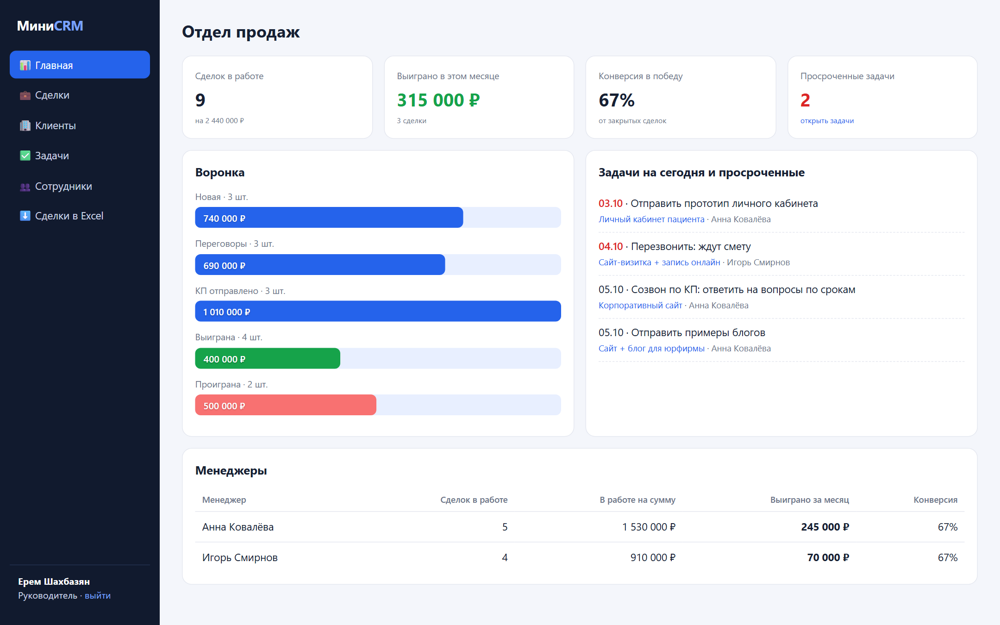
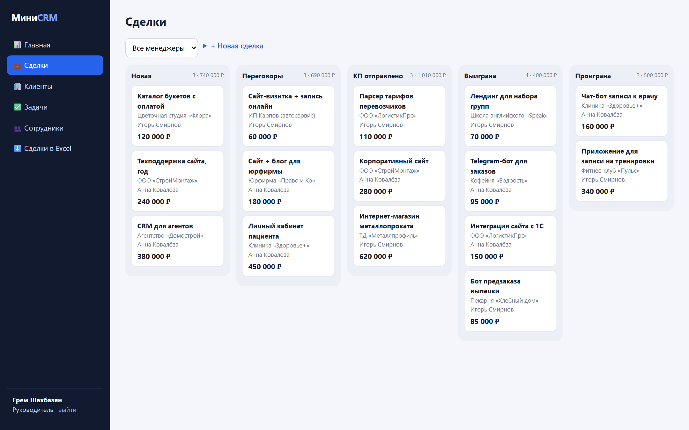
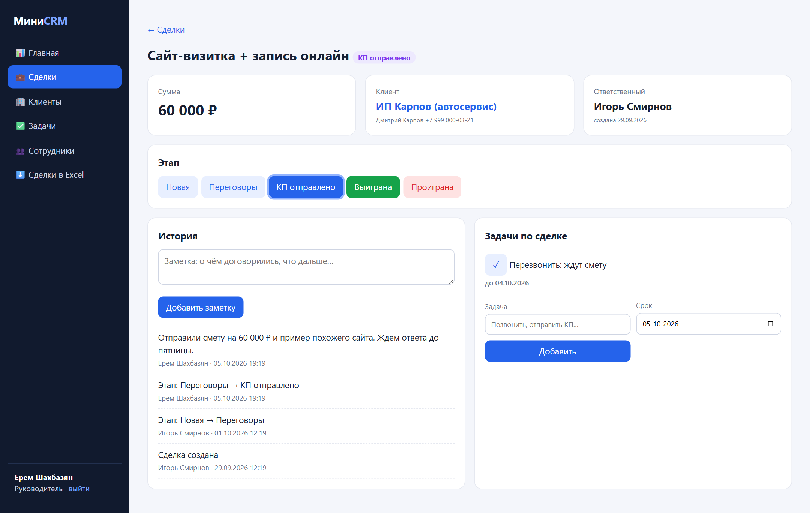
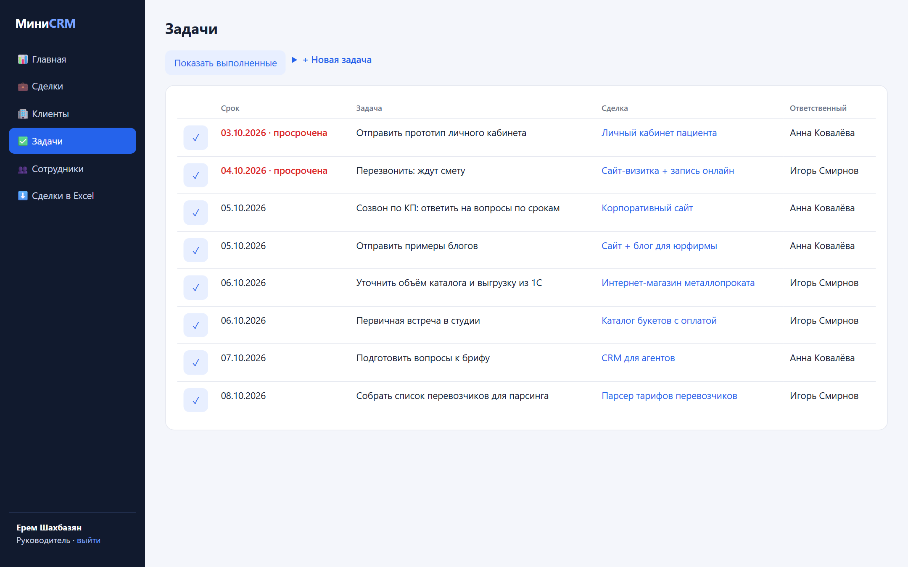
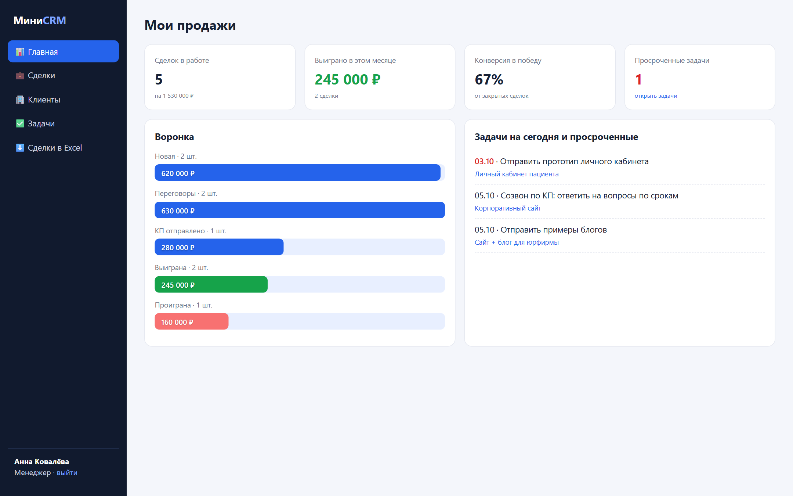
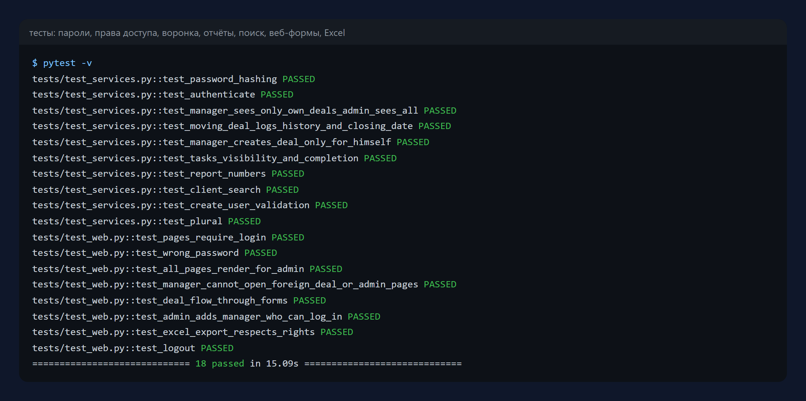

# Mini CRM for a sales team

[Русская версия](README.md)

A small CRM for a studio, an agency or any business with several
managers: clients, a deal pipeline, tasks with due dates, history for each
deal, reports for the team lead and export to Excel. A web interface with no
frontend build step — it starts with one command.

Python 3.11+ · FastAPI · SQLAlchemy 2 · Jinja2 · openpyxl · pytest



## Features

- **Roles.** The team lead sees the whole team, manages employees and
  assigns deals. A manager sees only their own deals and tasks — other people's
  are not accessible even by a direct link.
- **Deal pipeline.** A board by stage: new → negotiation → proposal sent →
  won / lost, with totals per column and a filter by manager.
- **Deal card.** Stage change in one click, history: who changed what and
  when, notes on what was agreed, tasks for the deal.
- **Tasks.** Due dates, overdue tasks are highlighted, "due today" is on the home page.
- **Clients.** Cards with contacts and all of the client's deals, search by
  name, contact, phone and email — handling Russian letters in any case.
- **Reports.** Deals in progress and their total amount, won this month, win
  rate, overdue tasks, pipeline by stage, comparison of managers.
- **Excel.** Deal export that respects permissions: a manager gets only their own.

| Pipeline | Deal card |
|---|---|
|  |  |

| Tasks | Manager's workspace |
|---|---|
|  |  |

## Security

- passwords are stored as salted PBKDF2-SHA256, comparison is constant-time;
- the session is in a signed cookie (`SameSite=Lax`); the signing key is set in
  `CRM_SECRET_KEY`;
- permissions are checked on every request, "someone else's" and "does not exist"
  look the same — 404, so as not to hint that the object exists.

## Running

```bash
pip install -r requirements.txt
python -m crm              # http://127.0.0.1:8000, creates a demo team if the database is empty
```

Demo login: team lead `boss@demo.ru`, managers `anna@demo.ru` and
`igor@demo.ru`, password `demo12345`. The demo data is a fictional web studio.

Settings are passed through environment variables: `CRM_DATABASE_URL` (SQLite by
default, PostgreSQL works too), `CRM_SECRET_KEY`, `HOST`, `PORT`.

## Tests

```bash
pytest -v
```

Passwords, permissions (a manager cannot see or change other people's data — both
in the logic and through the web interface), stage changes and history, reports,
search in Russian, creating employees, the scenario "created a deal → changed the
stage → note → task" through forms, Excel export that respects permissions.



## Structure

```
crm/services.py   logic without the web: permissions, pipeline, tasks, reports, search
crm/app.py        pages and forms (FastAPI), login and roles
crm/models.py     employees, clients, deals, history, tasks
crm/security.py   password hashing
crm/export.py     export to Excel
crm/seed.py       demo data
crm/templates/    pages (Jinja2), crm/static/ — styles
tests/            tests
```

## License

MIT — see [LICENSE](LICENSE).
