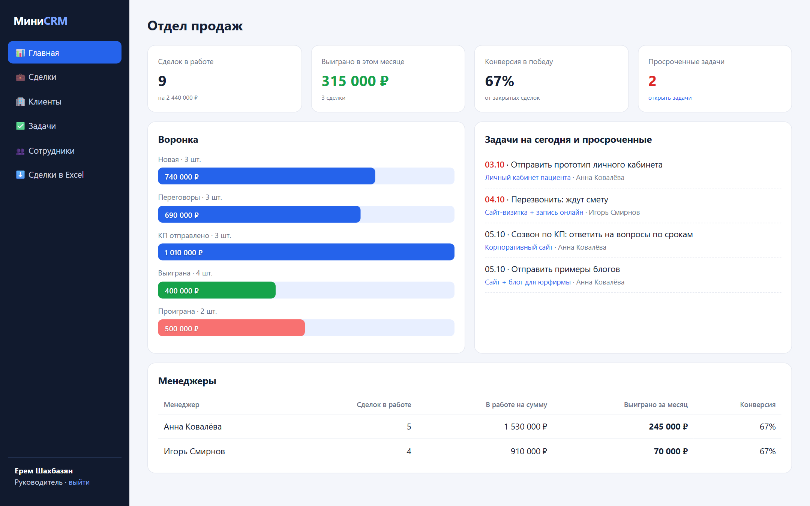
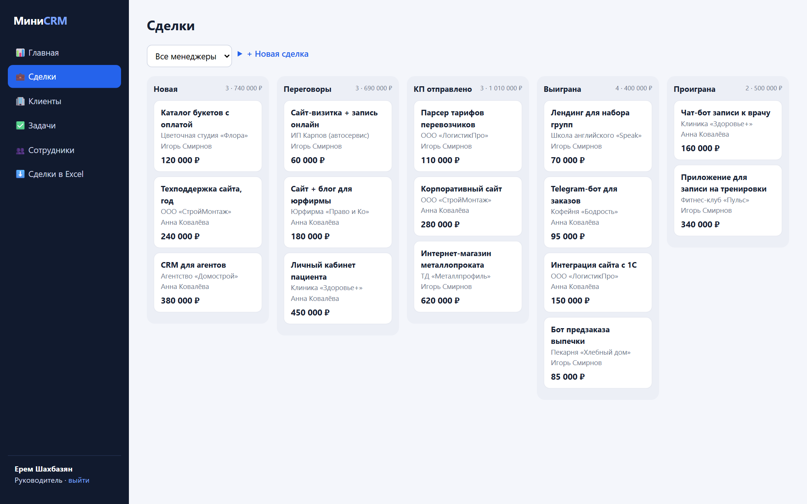
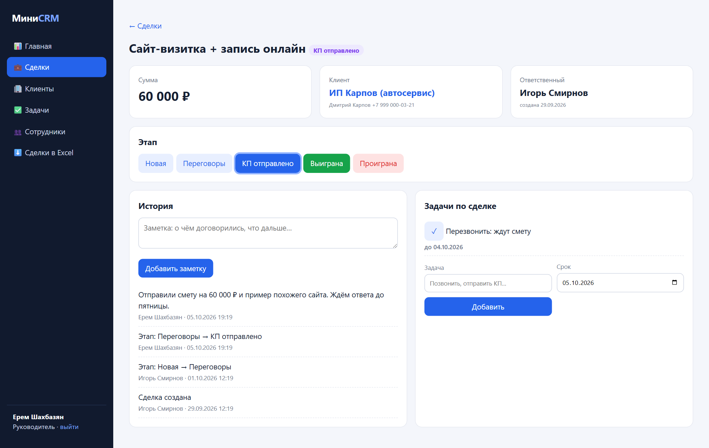
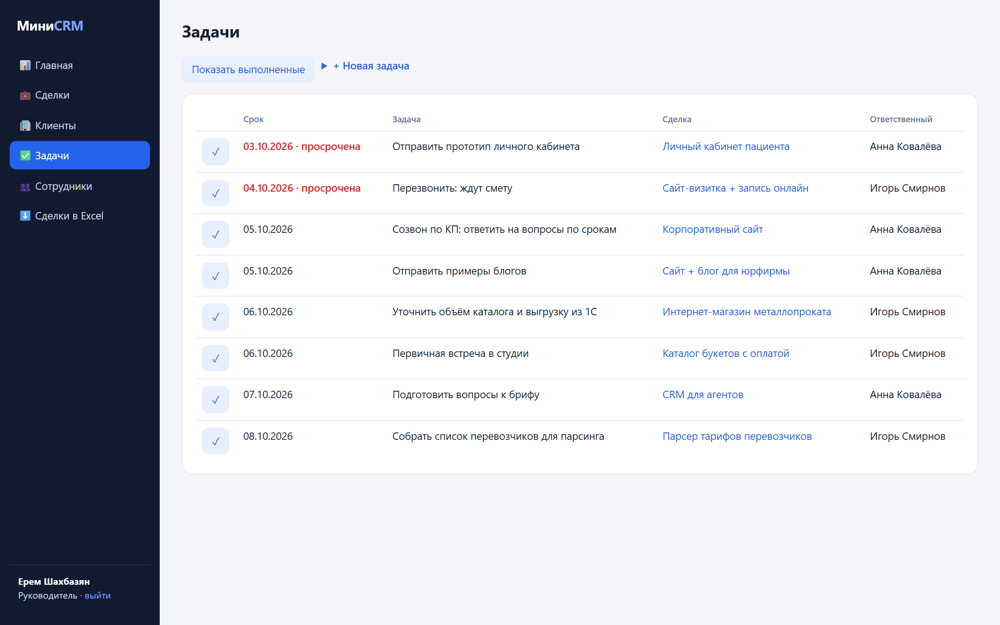
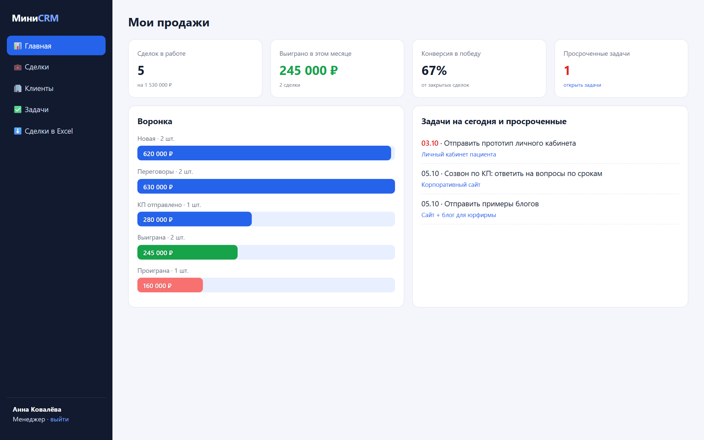
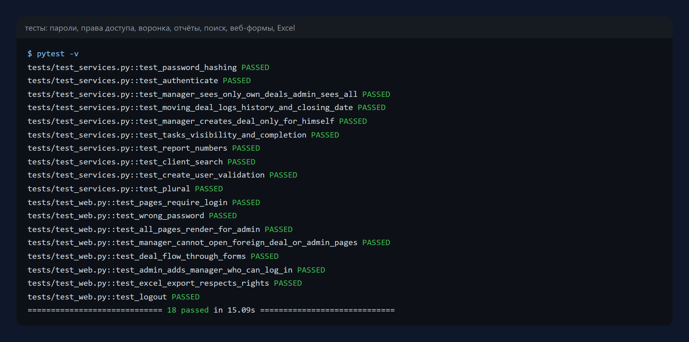

# Мини-CRM для отдела продаж

Небольшая CRM для студии, агентства или любого бизнеса с несколькими
менеджерами: клиенты, воронка сделок, задачи со сроками, история по каждой
сделке, отчёты для руководителя и выгрузка в Excel. Веб-интерфейс без сборки
фронтенда — запускается одной командой.

Python 3.11+ · FastAPI · SQLAlchemy 2 · Jinja2 · openpyxl · pytest



## Что умеет

- **Роли.** Руководитель видит весь отдел, управляет сотрудниками и
  назначает сделки. Менеджер видит только свои сделки и задачи — чужие
  недоступны даже по прямой ссылке.
- **Воронка сделок.** Доска по этапам: новая → переговоры → КП отправлено →
  выиграна / проиграна, с суммами по колонкам и фильтром по менеджеру.
- **Карточка сделки.** Смена этапа в один клик, история: кто, когда и что
  поменял, заметки по договорённостям, задачи по сделке.
- **Задачи.** Сроки, просроченные подсвечены, «на сегодня» — на главной.
- **Клиенты.** Карточки с контактами и всеми сделками клиента, поиск по
  названию, контакту, телефону и email — с учётом русских букв в любом регистре.
- **Отчёты.** Сделок в работе и на какую сумму, выиграно за месяц, конверсия
  в победу, просроченные задачи, воронка по этапам, сравнение менеджеров.
- **Excel.** Выгрузка сделок с учётом прав: менеджер получает только свои.

| Воронка | Карточка сделки |
|---|---|
|  |  |

| Задачи | Кабинет менеджера |
|---|---|
|  |  |

## Безопасность

- пароли хранятся как PBKDF2-SHA256 с солью, сравнение — за постоянное время;
- сессия в подписанной cookie (`SameSite=Lax`); ключ подписи задаётся в
  `CRM_SECRET_KEY`;
- права проверяются на каждом запросе, «чужое» и «несуществующее»
  выглядят одинаково — 404, чтобы не подсказывать, что объект есть.

## Запуск

```bash
pip install -r requirements.txt
python -m crm              # http://127.0.0.1:8000, при пустой базе создаст демо-отдел
```

Демо-вход: руководитель `boss@demo.ru`, менеджеры `anna@demo.ru` и
`igor@demo.ru`, пароль `demo12345`. Демо-данные — вымышленная веб-студия.

Настройки через переменные окружения: `CRM_DATABASE_URL` (по умолчанию
SQLite, подойдёт и PostgreSQL), `CRM_SECRET_KEY`, `HOST`, `PORT`.

## Тесты

```bash
pytest -v
```

Пароли, права (менеджер не видит и не меняет чужое — и в логике, и через
веб-интерфейс), смена этапов и история, отчёты, поиск по-русски, создание
сотрудников, сценарий «создал сделку → сменил этап → заметка → задача» через
формы, выгрузка в Excel с учётом прав.



## Структура

```
crm/services.py   логика без веба: права, воронка, задачи, отчёты, поиск
crm/app.py        страницы и формы (FastAPI), вход и роли
crm/models.py     сотрудники, клиенты, сделки, история, задачи
crm/security.py   хеширование паролей
crm/export.py     выгрузка в Excel
crm/seed.py       демо-данные
crm/templates/    страницы (Jinja2), crm/static/ — стили
tests/            тесты
```

## Лицензия

MIT — см. [LICENSE](LICENSE).
